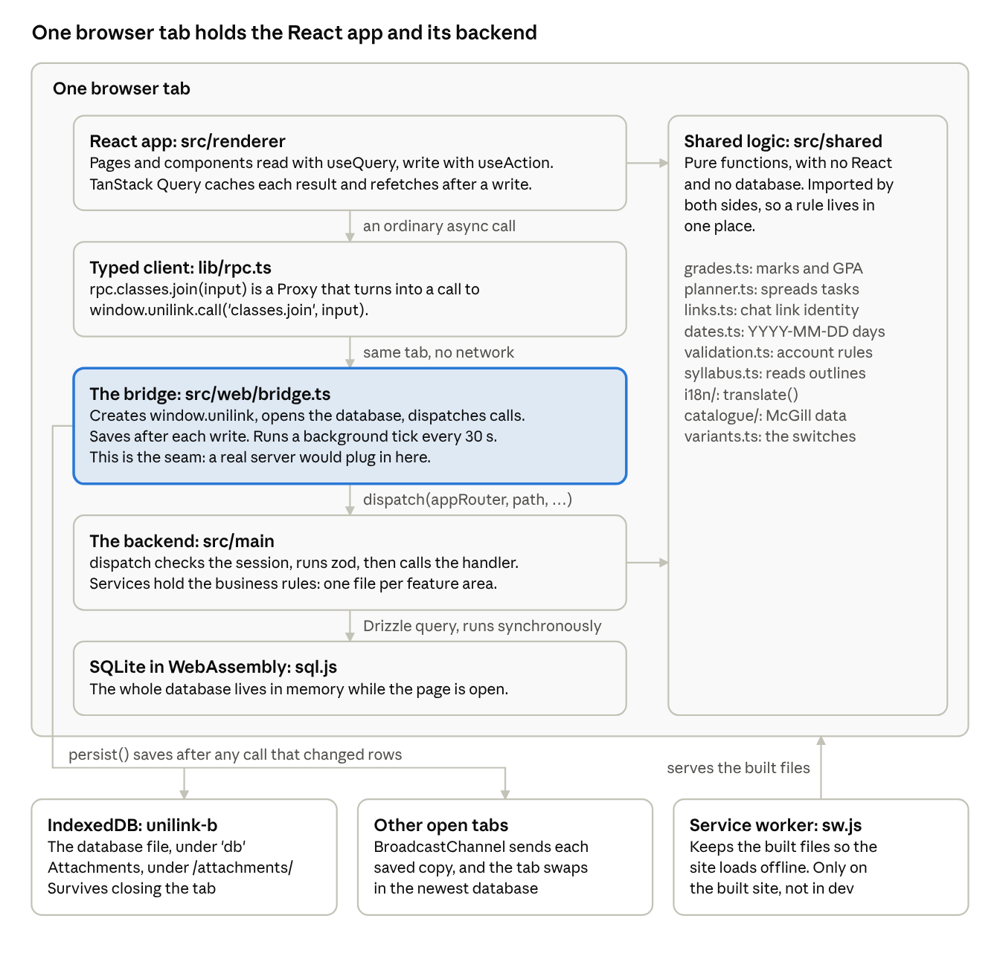
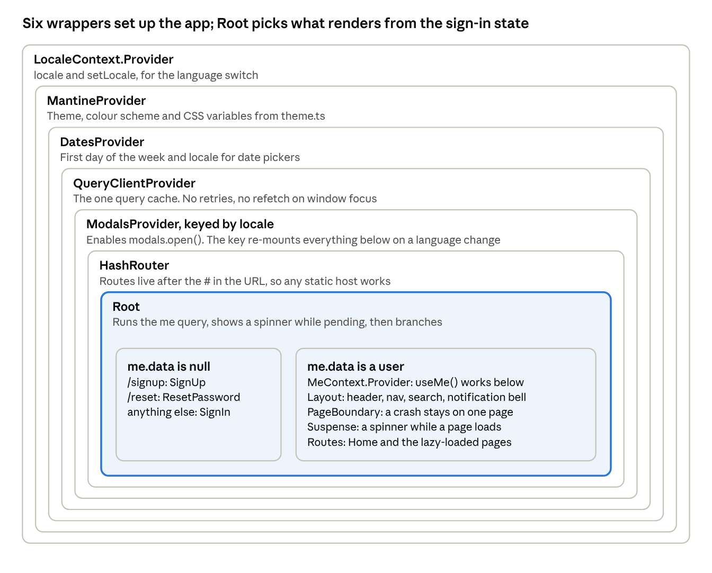
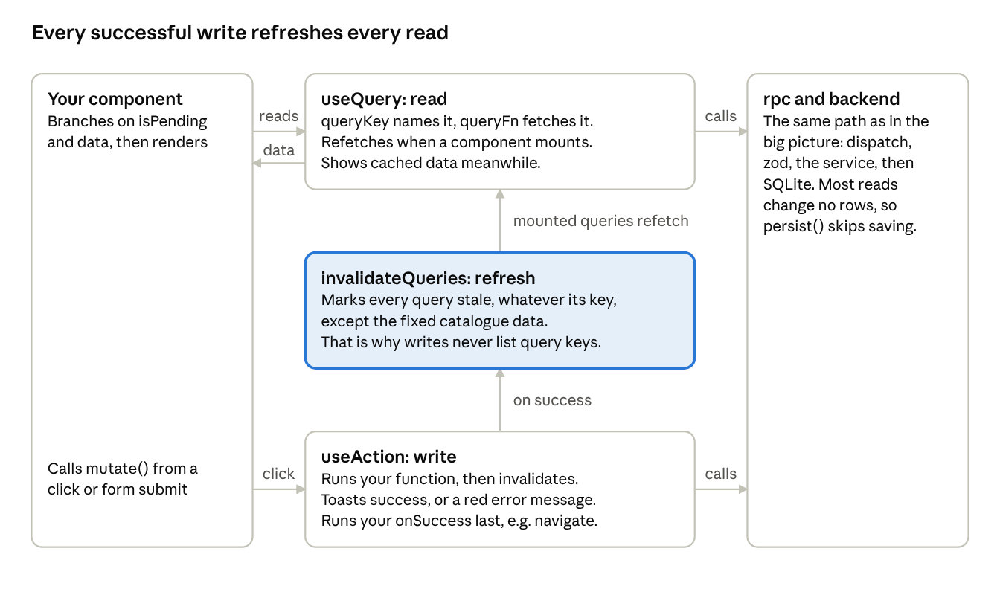
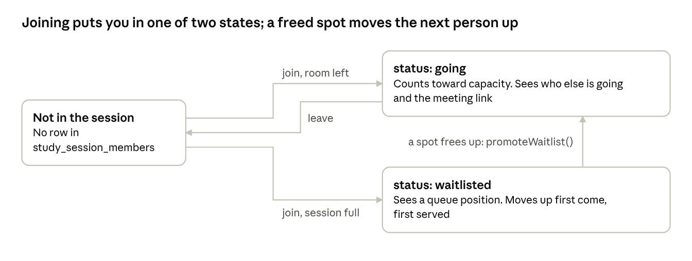
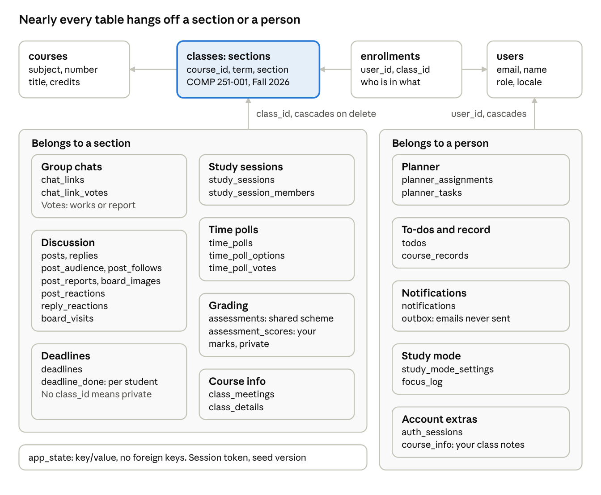

# UniLink B Web Port: How the Codebase Works

This README explains how the code works, for a developer comfortable with React. For what the app does and the product decisions behind it, see [docs/PRODUCT.md](docs/PRODUCT.md). The live site is at https://austinjradi.github.io/unilink-b/.

*Last checked against the code on November 5, 2026.*

## Start here

UniLink B has no server: its "backend" is TypeScript that runs inside the browser tab, next to the React app, and saves a real SQLite database to IndexedDB. Hold on to that one idea and the rest of the codebase makes sense.

UniLink is a study app for McGill students: classes, classmates, discussion boards, study sessions, deadlines, grades and assignment planning. It started as an Electron desktop app. This repo (`unilink-web-b`, called "version B") is the same code moved to a static website, with different product decisions from the first web port, "version A".

### Who this guide is for

You are comfortable with components, props, `useState`, `useEffect`, custom hooks and context. You do not need to know the libraries here. Each one is explained the first time it matters, and the last section has a short refresher on the React features you may not use every day.

### What will feel unfamiliar

- **The server is a function call.** `rpc.classes.join({ classId })` looks like a network request but runs in the same tab. Nothing goes over the network.
- **Folder names come from Electron.** `src/main` is the backend and `src/renderer` is the React app. The names were kept on purpose, so changes can be compared with the desktop app.
- **There is no global state library.** No Redux or Zustand. Nearly all shared state is server state, held by TanStack Query.
- **Everyone's data is in your browser.** Classmates are demo accounts seeded into your local database, so "other users" only exist in that browser.

### Where to go next

| If you want to… | Read |
| --- | --- |
| See how everything connects | The big picture |
| Run the app and find your way around the folders | Running it locally |
| Understand a page or component | Frontend architecture, then State and data fetching |
| Follow one feature from click to database | Key features walkthrough |
| Add or change backend behaviour | Backend and API, then Database |
| Make a specific change quickly | How to make common changes |

### A reading order for your first day

These files show the whole architecture in a few hundred lines, so read them in order:

1. `src/web/main.ts`, then `src/web/bridge.ts`: how the app starts and where the database lives.
2. `src/main/rpc/core.ts` and `src/main/rpc/router.ts`: what a procedure is and how calls run.
3. `src/renderer/src/lib/rpc.ts` and `lib/hooks.ts`: how React calls the backend.
4. `src/renderer/src/App.tsx`: providers, routes and the auth gate.
5. `src/shared/links.ts`, `src/main/services/links.ts`, then `pages/class/GroupChats.tsx`: one complete feature.
6. The `S2 group chat links` tests in `tests/services.test.ts`: the same feature as a story.

Paths in this guide are relative to the repo root. Line counts and line numbers were checked on November 5, 2026, and drift as the code changes. [docs/PRODUCT.md](docs/PRODUCT.md), which was this repo's README before this guide, is the best record of product decisions; this guide covers how the code works.

## The big picture

Every click travels down a stack of plain function calls inside one tab, and only a saved copy of the database ever leaves memory.



Results return up the same path. The bridge is highlighted because it is the seam: move `src/main` behind an HTTP API, change `window.unilink.call`, and the React app would not notice. Smaller per-browser things (language, requirement switches, unsent drafts) live in `localStorage`.

### What happens when the page loads

1. `index.html` loads one script, `src/web/main.ts`. It imports `./bridge` first, then the React app.
2. Importing `bridge.ts` calls `start()` straight away and defines `window.unilink`. `start()` is asynchronous, so its promise is stored as `ready`.
3. `start()` loads the sql.js WebAssembly file and any saved database from IndexedDB, then calls `openDatabase` in `main/db/client.ts`. That turns on foreign keys, runs pending migrations and seeds the sample courses.
4. `seedDemoData` adds classmates and sections if this browser's demo is missing or out of date. `persist()` then saves the result.
5. `start()` builds the `ctx` object every procedure receives, listens for other tabs, and starts the background tick (after 3 seconds, then every 30).
6. Meanwhile React has rendered. `Root` in `App.tsx` runs `useQuery({ queryKey: ['me'], queryFn: () => rpc.auth.me() })`. That call awaits `ready`, so a spinner shows until the database is open.
7. `auth.me` restores the remembered session from the `app_state` table. A user sees the app; `null` shows the sign-in routes.

### One call, from click to database

Clicking **Join** on a class page runs this chain:

1. `pages/ClassPage.tsx` calls `join.mutate()`. `join` came from `useAction(() => rpc.classes.join({ classId }))`.
2. `rpc` is a JavaScript `Proxy`. Reading `.classes.join` builds a path, and calling it runs `window.unilink.call('classes.join', { classId })`.
3. `call` in `web/bridge.ts` awaits `ready`, then runs `dispatch(appRouter, path, input, ctx)`.
4. `dispatch` in `main/rpc/core.ts` walks the router to find the procedure, checks `ctx.session.userId`, validates the input with zod, and runs the handler.
5. The handler in `main/services/classes.ts` checks the rules, then inserts a row: `ctx.db.insert(enrollments).values({ userId: ctx.userId, classId }).run()`.
6. Back in the bridge, `persist()` sees that `total_changes()` is above zero. It exports the database to bytes, posts them to other tabs, and saves them to IndexedDB.
7. The result comes back as `{ ok: true, data }`. The proxy unwraps it, or throws an `RpcError` when `ok` is false.
8. `useAction`'s `onSuccess` invalidates the query cache, so every mounted `useQuery` refetches. The page re-renders with `c.joined` now true, and a toast says "Joined!".

### The stack

| Library | Version | Its job here |
| --- | --- | --- |
| React | 19 | UI, in `StrictMode` |
| TypeScript | 7 | Strict mode. Types flow from services to components |
| Vite | 8 | Dev server and static build |
| Mantine | 9 | All UI components, forms, modals, toasts, theming |
| TanStack Query | 5 | Caches every read and refetches after writes |
| React Router | 8 | Client-side routes, using `HashRouter` |
| Drizzle ORM | 0.45 | Typed SQL queries and the schema |
| sql.js | 1.14 | SQLite compiled to WebAssembly |
| zod | 4 | Validates the input of every procedure |
| dayjs | 1 | Date formatting in the UI |
| @noble/hashes | 2 | scrypt and SHA-256, since Web Crypto has no scrypt and is missing on plain HTTP |
| KaTeX | 0.19 | Renders math in posts. Loaded only when needed |
| pdf.js | 6.4 | Reads attached PDFs. Loaded only when needed |
| Vitest | 5 | Tests, in plain Node |

### Why it is built this way

- **A shareable link instead of an installer.** A static site lets anyone try the desktop app without downloading it. `package.json` calls it a static website for demos.
- **The services stayed the same.** better-sqlite3 and sql.js are both synchronous, so backend code moved over almost unchanged.
- **Same folders as the desktop app.** `diff -r ../unilink/src src` shows the differences, so fixes can move between projects.

The trade-off is real: data exists only in one browser. Classmates are seeded demo accounts, and two real people on two computers can never see each other.

## Running it locally

You need Node 22 or newer. Run `pnpm install`, then `pnpm run dev`, and the whole app is at `http://localhost:5173`. There is no database, server or `.env` file to set up, because everything runs in the page.

### Commands

| Command | What it does |
| --- | --- |
| `pnpm run dev` | Vite dev server with hot reload, port 5173 |
| `pnpm test` | Runs all Vitest suites once (382 tests, about 85 seconds) |
| `pnpm run typecheck` | `tsc --noEmit`. CI runs this before the tests |
| `pnpm run build` | Builds the static site into `dist/` |
| `pnpm run preview` | Serves `dist/` at port 4173. Use it to test the service worker and offline mode |
| `pnpm run db:generate` | Creates a migration after you edit `src/main/db/schema.ts` |
| `node scripts/i18n-keys.mjs` | Lists English UI strings with no French translation |

### Signing in

The database seeds itself on first load, so there is data straight away. The sign-in screen lists three demo students and one demo professor. All demo accounts share `DEMO_PASSWORD` from `src/main/db/demo.ts`.

To see the social features from two sides, open a second tab and sign in as someone else. Each tab keeps its own sign-in, and saved changes reach the other tab. **Reset demo data** on the sign-in screen wipes the browser's copy and starts again.

### Folder map

```text
src/
  web/            Replaces Electron: entry point, bridge, storage, service worker
    main.ts       The real entry point, loaded by index.html
    bridge.ts     Creates window.unilink and owns the database
    platform.ts   File picker, downloads, notifications, reading PDFs
    storage.ts    IndexedDB wrapper
    node/         Browser stand-ins for node:fs/promises and node:path
  main/           The backend, running in the page
    db/           schema.ts, client.ts, migrations.ts, demo seed data
    rpc/          core.ts (procedure, dispatch), router.ts (the whole API)
    services/     One file per feature area
    crypto.ts     scrypt, sha256 and random helpers
  renderer/src/   The React app
    main.tsx      createRoot, global CSS imports
    App.tsx       Providers, routes, the query client
    pages/        One file per route; pages/class/ holds the class page's tabs
    components/   Shared pieces and large features (Feed, Sessions, GradeCalculator)
    lib/          RPC client, hooks, i18n, drafts, undo, formatting
    theme.ts      Mantine theme
    styles.css    Global CSS
  shared/         Pure logic imported by both sides
    i18n/         translate(), English plurals, French dictionaries
    catalogue/    Loader and JSON data for McGill's catalogue
drizzle/          SQL migrations generated from schema.ts
scripts/          Catalogue import (Python), i18n key collector
tests/            Vitest suites
public/           Icons and the web manifest, copied as they are
```

### Import rules worth knowing

- **`@shared/*`** and **`@renderer/*`** are path aliases, set in `tsconfig.json` and `vite.config.ts`.
- **The renderer imports only types from `src/main`.** `lib/rpc.ts` uses `import type`, so the compiler knows the API shape without React code reaching into services. All real calls go through `rpc`.
- **Services import `node:fs/promises`, and it still works in the browser.** `vite.config.ts` aliases it to `src/web/node/fs.ts`. Vitest has no such alias, so tests use the real Node module.

The codebase is about 41,000 lines including tests. Most files are small, but a few are large: `components/Feed.tsx` (1,905 lines), `pages/Calendar.tsx` (1,379) and `components/Sessions.tsx` (1,032). Expect several components per file in those.

## Frontend architecture

The React tree is a stack of providers, an auth gate called `Root`, then `Layout` wrapping lazy-loaded pages. Almost all of it is in one file, `src/renderer/src/App.tsx`.



A few things sit beside these wrappers: `Notifications` (toasts), `ReqInfoHost` (the info popup), `RequirementsView` (a full-page list of requirements) and `SiteBlockers`.

### Details in that tree that matter

- **The language key.** `<ModalsProvider key={locale}>` re-mounts everything below it when the language changes. That is why `t()` can be a plain function instead of a hook: nothing has to subscribe, because everything renders again from scratch.
- **`HashRouter`.** URLs look like `/#/classes/3/sessions`. The server only ever sees `/`, so GitHub Pages needs no rewrite rule, even from a subfolder.
- **Hidden, not unmounted.** When the requirements list opens, the site is wrapped in `display: none` rather than removed, so half-filled forms survive the trip.

### The auth gate

`Root` runs one query and branches on it. This is the whole sign-in check for the UI:

```tsx
const me = useQuery({ queryKey: ['me'], queryFn: () => rpc.auth.me() });

if (me.isPending) return <Center h="100vh"><Loader /></Center>;
if (!me.data) return <Routes>{/* /signup, /reset, and SignIn for anything else */}</Routes>;

return (
  <MeContext.Provider value={me.data}>
    <Layout>{/* PageBoundary, Suspense, Routes */}</Layout>
  </MeContext.Provider>
);
```

Inside the signed-in tree, `useMe()` from `lib/hooks.ts` returns the user and is never null. It throws if used outside that tree, so components can skip null checks.

Signing in and out need no special code. Both go through `useAction`, which invalidates all queries, so `me` refetches and `Root` re-renders. A session that ends mid-use is caught separately: the procedure fails with `UNAUTHORIZED`, and the query cache's `onError` in `App.tsx` runs `queryClient.setQueryData(['me'], null)`.

### Routes

| URL | Component | File |
| --- | --- | --- |
| `/` | `Home` | `pages/Home.tsx` (not lazy) |
| `/courses/:tab?` | `CoursesPage` | `pages/Classes.tsx` |
| `/classes/:classId/:tab?` | `ClassPage` | `pages/ClassPage.tsx` |
| `/catalogue/:tab?/:id?` | `CataloguePage` | `pages/Catalogue.tsx` |
| `/calendar` | `CalendarPage` | `pages/Calendar.tsx` |
| `/planner` | `PlannerPage` | `pages/Planner.tsx` |
| `/calculator` | `CalculatorPage` | `pages/Calculator.tsx` |
| `/sessions`, `/sessions/search` | `SessionsPage`, `SessionSearchPage` | `pages/Sessions.tsx` |
| `/sessions/join/:code` | `SessionInvitePage` | `pages/Sessions.tsx` |
| `/study-mode` | `StudyModePage` | `pages/StudyMode.tsx` |
| `/settings/:tab?` | `SettingsPage` | `pages/Settings.tsx` |
| `/signup`, `/reset`, anything else signed out | `SignUp`, `ResetPassword`, `SignIn` | `pages/Auth.tsx` (not lazy) |

Older paths such as `/focus` and `/integrations` redirect with `<Navigate>`. They stay because links stored in old notifications still point at them. A file can hold several pages: `pages/Classes.tsx` also exports `AcademicsPage`, and `pages/Settings.tsx` also exports `ProfilePage`.

### Code splitting

Sign-in and Home ship in the main bundle. Other pages load on first visit through a small helper around `React.lazy`, which expects a default export, so the helper adapts named exports:

```tsx
const page = <K extends string>(load: () => Promise<Record<K, ComponentType>>, name: K) =>
  lazy(() => load().catch(reloadForNewVersion).then((m) => ({ default: m[name] })));

const CalendarPage = page(() => import('./pages/Calendar'), 'CalendarPage');
```

The `.catch(reloadForNewVersion)` handles a real problem. After a deploy, a tab left open asks for old hashed files that no longer exist. The helper reloads the page once to pick up the new version, and uses `sessionStorage` to avoid a reload loop if the network is truly down.

If that fails, `PageBoundary` takes over. It is the app's one class component, because React still has no hook for error boundaries. It resets when the path changes, so one broken page does not block navigation.

After startup, `preloadCatalogue` in `lib/preload.ts` fetches catalogue data and likely pages one at a time during browser idle time, unless the visitor has data saver on.

### `Layout`

`components/Layout.tsx` draws the header and wraps each page. Three parts are worth reading:

- **`NAV`**, a plain array of tabs. A `filter` removes items by role and by requirement switch, then one `.map` draws desktop tabs and another draws the phone menu.
- **`useEffect` for `document.title`**, which names the tab after the current section.
- **`SaveProblem`**, a red alert shown if saving to IndexedDB fails. It subscribes with `window.unilink.onSaveProblem`.

### Where components live

| Folder | What goes there | Examples |
| --- | --- | --- |
| `pages/` | One component per route | `Home`, `Calendar`, `Planner` |
| `pages/class/` | One tab of the class page | `Overview`, `GroupChats`, `Assignments` |
| `components/ui.tsx` | Small shared pieces | `PageHeader`, `SectionCard`, `Empty`, `Loading`, `Tag`, `KindBadge` |
| `components/` | Features used in more than one place | `Feed`, `GradeCalculator`, `Sessions` |
| `lib/` | Hooks and helpers with no page of their own | `rpc`, `useAction`, `useUndo`, drafts |

Reuse shows up clearly in `Feed` and `GradeCalculator`. `pages/class/Discussion.tsx` is just `<Feed classId={classId} />`, and Home renders `<Feed left={left} />` with no class. `Feed` treats a missing `classId` as "all my classes".

### A tab that lives in the URL

The class page keeps its current tab in the route, not in `useState`, so links and the back button work:

```tsx
const tabInUrl = TABS.some((item) => item.value === params.tab) ? params.tab! : 'overview';

<Tabs value={tab} onChange={(v) => navigate(`/classes/${classId}/${v}`)} keepMounted={false}>
```

`keepMounted={false}` means only the open tab is mounted, so its queries run only when someone opens it. The feed does the same with `?post=12` through `useSearchParams`, so an open thread has a shareable URL.

## State and data fetching

Nearly all shared state is data from the backend, and TanStack Query holds it. Two hooks cover almost everything: `useQuery` for reads (about 120 calls) and `useAction`, this repo's own hook, for writes (about 180).



You never have to work out which queries a write affects. A successful write refreshes every read on screen, which is cheap because the data is local. There are no optimistic updates anywhere.

### Where each kind of state lives

| Kind of state | Where it lives | How you use it |
| --- | --- | --- |
| Backend data | TanStack Query cache | `useQuery`, `useAction` |
| The signed-in user | `MeContext`, filled from the `me` query | `useMe()` |
| Language | A module variable plus `LocaleContext` | `t()`, `useLocale()` |
| Current page, tab or open thread | The URL | `useParams`, `useSearchParams` |
| Open modals, filters, toggles | `useState` in the component | `const [showHidden, setShowHidden] = useState(false)` |
| Form fields | `useForm` from `@mantine/form` | `form.getInputProps('url')` |
| Requirement switches | A module variable plus `localStorage` | `useVariant('no-browse-links')` |
| Unsent posts and replies | `localStorage`, per account | `loadDraft`, `saveDraft` in `lib/drafts.ts` |
| Small per-browser preferences | `localStorage` | `useLocalStorage` from `@mantine/hooks` |
| Toasts and confirm dialogs | Mantine's imperative APIs | `notifications.show()`, `modals.openConfirmModal()` |

### Reading with `useQuery`

This is the shape nearly every component uses, taken from `pages/class/GroupChats.tsx`:

```tsx
const links = useQuery({
  queryKey: ['links', classId],
  queryFn: () => rpc.links.list({ classId }),
});
const shown = links.data?.filter((l) => !l.hidden && !l.pending) ?? [];

return links.isPending ? <Loading /> : shown.length ? <LinkList /> : <Empty />;
```

The `queryKey` is the cache address. Two components using the same key share one fetch and one result. Every value the fetch depends on belongs in the key, so `Feed` uses `['board', 'feed', classId ?? null, feedFilters]` and refetches whenever a filter changes. By convention, the first item is the service name: `classes`, `calendar`, `board`.

The global defaults in `App.tsx` are `retry: false` and `refetchOnWindowFocus: false`. A local call that failed would just fail again, so retrying adds nothing. These per-query options come up often:

| Option | What it does | Where |
| --- | --- | --- |
| `enabled: !!classId` | Skips the query until the condition is true | `Feed` |
| `placeholderData: keepPreviousData` | Keeps old results on screen while new ones load, so lists don't flash empty | `Feed`, `GlobalSearch`, `Calendar` |
| `refetchInterval: 15_000` | Polls | `NotificationBell`, study mode status |
| `staleTime: Infinity` | Never refetches, for data that cannot change | Catalogue JSON |
| `select: toCodes` | Reshapes the cached data for this one caller | `CatalogueLink` |

Polling exists for one reason. The background tick writes notifications without going through `useAction`, so nothing invalidates the cache. The bell polls so it can notice them.

`useInfiniteQuery` appears once, in `pages/Classes.tsx`, to page through course search results. `Feed` takes a simpler route: `board.feed` returns at most 100 posts, and it renders only `feed.data.slice(0, shownPosts)`. `components/LoadOnScroll.tsx` raises that number with an `IntersectionObserver` as you near the bottom.

### Types come from the backend

There are no hand-written API types. A component derives them from what the service returns:

```tsx
type ChatLink = Out<typeof rpc.links.list>[number];
```

`rpc` is typed as `RpcClient<AppRouter>`, a mapped type in `main/rpc/core.ts` that turns each procedure into an async function. Rename a field in a service, and every component using it fails `pnpm run typecheck`.

Because nothing is serialized, **a `Date` from the database reaches your component as a real `Date`**, so `link.createdAt.getTime()` works. In a normal HTTP app that value would be a string. Keep this in mind if the backend ever moves to a real server.

### Writing with `useAction`

`lib/hooks.ts` wraps TanStack's `useMutation`. Writes should go through it, because it handles the cache and the toasts. Here is its core, with the offline-queue switch removed:

```tsx
export function useAction<I = void, O = unknown>(fn: (input: I) => Promise<O>, options: ActionOptions<I, O> = {}) {
  const queryClient = useQueryClient();
  return useMutation({
    mutationFn: async (input: I) => fn(input),
    onSuccess: async (data, input) => {
      await queryClient.invalidateQueries({ predicate: changesWithWrites });
      const message = typeof options.success === 'function' ? options.success(data, input) : options.success && t(options.success);
      if (message) notifications.show({ color: 'teal', message });
      options.onSuccess?.(data, input);
    },
    onError: (error) => notifications.show({ color: 'red', title: t("That didn't work"), message: error.message }),
  });
}
```

Three typical uses:

```tsx
// No input: the values are already in scope.
const remove = useAction(() => rpc.links.remove({ linkId: link.id }), { success: 'Link removed' });
<Button onClick={() => remove.mutate()} loading={remove.isPending} />

// Input passed to mutate().
const decide = useAction((keep: boolean) => rpc.links.decide({ linkId: link.id, keep }));
decide.mutate(true);

// Close a modal or navigate afterwards.
const join = useAction((classId: number) => rpc.classes.join({ classId }), {
  onSuccess: (_data, classId) => navigate(`/classes/${classId}`),
});
```

A few details to remember:

- **A `success` string is an English key.** `useAction` translates it for you. A `success` function must return text that is already translated.
- **You rarely need `try`/`catch`.** A failed procedure throws `RpcError`, and `useAction` shows its translated message in a red toast.
- **Catalogue data is exempt from invalidation.** `changesWithWrites` in `lib/preload.ts` skips it, because those JSON files never change while the page is open.
- **Undo has its own helper.** `useUndo` in `lib/undo.tsx` shows a toast with an Undo button for things deleted without a confirmation.

A few writes skip `useAction` on purpose. `rpc.board.seen({ classId })` in `Feed` runs in a `useEffect` with no invalidation, so posts keep their New badge until the next visit.

### Forms

The app has about 16 forms using `useForm` from `@mantine/form`. Here is `LinkForm` from `GroupChats.tsx`, shortened:

```tsx
const form = useForm({
  initialValues: { url: existing?.url ?? '', label: existing?.label ?? '' },
  validate: { url: (v) => (parseChatLink(v) ? null : t('Paste a full link, starting with https://')) },
});
const save = useAction((v: typeof form.values) => rpc.links.add({ classId, ...v }), { onSuccess: onDone });

return (
  <form onSubmit={form.onSubmit((v) => save.mutate(v))}>
    <TextInput label={t('Invite link')} {...form.getInputProps('url')} />
    <Button type="submit" loading={save.isPending}>{t('Share link')}</Button>
  </form>
);
```

`getInputProps` supplies `value`, `onChange` and `error`. `parseChatLink` comes from `@shared/links`, and the service calls it too, so the form and the backend cannot disagree. The form check gives quick feedback, and the backend check is the one that counts.

The parent renders the form with `key={editing === 'new' ? 'new' : editing.id}`. Changing the key gives a fresh component, which resets the fields when you edit a different link.

### State outside React

A few values must be readable from non-React code, so they live in plain modules and React subscribes with `useSyncExternalStore`. Requirement switches are the main example:

```ts
// src/shared/variants.ts: no React here, so services can use it too.
let on = load();
const listeners = new Set<() => void>();
export const isOn = (id: VariantId) => on.includes(id);
export function subscribeVariants(listener: () => void) {
  listeners.add(listener);
  return () => { listeners.delete(listener); };
}

// src/renderer/src/lib/variants.ts: the React side.
export const useVariant = (id: VariantId) => useSyncExternalStore(subscribeVariants, () => isOn(id));
```

The hook takes a subscribe function and a snapshot function, and re-renders when the snapshot changes. `lib/reqView.ts` uses the same pattern, and so does the popup in `ReqInfo.tsx`.

### Requirement switches: the pattern you will see most

This project reviews a requirements board, so the site can demonstrate other answers to each open question. Each small info icon opens a popup listing the alternatives, and many have a button that switches the live site to that alternative.

There are 374 switches in `VARIANTS` in `shared/variants.ts`. That explains the long `useVariant` lists at the top of components, and the `isOn` checks through the services:

```tsx
// In a component (about 400 of these)
const noBrowseLinks = useVariant('no-browse-links');

// In a service (about 280 of these)
if (isOn('whatsapp-discord-only') && parsed.platform !== 'WhatsApp' && parsed.platform !== 'Discord') throw new AppError(ONLY_WHATSAPP_DISCORD);
```

**When reading a component, ignore the switches first.** Assume each one is off and read the default path, then come back to them if you need to. The default behaviour is version B as designed.

- **Icons:** `<ReqInfo id="chat-add" />` draws one icon, and `<WithInfo id="chat-add">` wraps a control and adds one. The text lives in `lib/reqTopics.ts`, in English only.
- **Applying a switch:** `useApply` in `ReqInfo.tsx` flips it and invalidates every query, because services return different data afterwards.
- **Data under a switch:** when a switch needs extra data, such as which posts are anonymous, `services/variantData.ts` keeps it as JSON in `app_state`. The real tables stay as version B was built.
- **Tests enforce this:** `tests/reqInfo.test.ts` fails if an icon has no topic, a topic has no icon, or a switch is never checked in the code.

## Key features walkthrough

The quickest way in is to follow one small feature end to end, and group chat links are the smallest complete slice. The other features have the same shape but more rules.

A feature usually has four parts:

| Layer | Where | Holds |
| --- | --- | --- |
| Tables | `main/db/schema.ts` | The data |
| Pure rules | `shared/<feature>.ts` | Logic with no database, easy to test |
| Service | `main/services/<feature>.ts` | Access checks, queries, notifications, and a router of procedures |
| UI | `pages/` or `components/` | `useQuery`, `useAction`, Mantine components |

### Group chat links: the one to read first

Files: `pages/class/GroupChats.tsx` (512 lines), `services/links.ts` (301), `shared/links.ts` (88), and the tables `chat_links` and `chat_link_votes`.

**Adding a link.** `LinkForm` calls `rpc.links.add`. The procedure runs these steps in order:

1. `requireMember` throws `FORBIDDEN` unless you are in the section.
2. `parseChatLink` from `shared/links.ts` validates the URL, detects the platform, and builds a `chatKey`. `discord.gg/abc` and `discord.com/invite/abc` both become `discord:abc`, so the same chat is recognised under any URL.
3. `assertNotDuplicate` looks for that `chatKey` in every section of the course. A match throws `CONFLICT`, naming who shared it and where.
4. Drizzle inserts the row.

**Voting.** Classmates mark a link "works" or report it. The rule for hiding is one line in `shared/links.ts`:

```ts
export function isHidden(reports: number, works: number) {
  return reports >= HIDE_AFTER_REPORTS && reports > works; // HIDE_AFTER_REPORTS is 2
}
```

The `vote` procedure counts votes before and after the write, and notifies the owner only when a link goes from visible to hidden. That before-and-after check prevents repeat notifications on later reports.

**The UI.** `GroupChats` fetches the list and splits it into `shown`, `pending` and `hidden`. Each `LinkCard` declares its own actions: `works`, `report`, `remove`, `fixed`. `hidden` is computed in the service and returned as a field, so the UI never re-implements the rule.

### Discussion board: a large component

Files: `components/Feed.tsx` (1,905 lines), `services/board.ts` (937), `shared/postText.ts`. It is the largest component in the app, so here is a map:

| Component | Line | Job |
| --- | --- | --- |
| `Feed` | 657 | Entry point. Renders `FeedBoard` |
| `FeedBoard` | 707 | Filter state, the `board.feed` query, the list, the composer |
| `PostCard` | 514 | One post in the list |
| `PostThread` | 1322 | An open thread and its replies, from `board.get` |
| `ReplyItem`, `ReplyBox` | 1109, 1062 | One reply, and the box for writing one |
| `PostForm` | 1618 | Creating or editing a post |
| `Body` | 188 | Turns post text into code, math and links |
| `ReactionBar` | 150 | The goat reactions |

**Filtering.** `FeedBoard` keeps each filter in `useState`, builds a `feedFilters` object, and uses it as both the input and part of the key. Changing any filter triggers a new fetch. `useDebouncedValue(search, 200)` waits for a pause in typing, and `keepPreviousData` stops the list flashing.

**Who can see what.** The service enforces this in SQL, not in the UI. `canSeePost` returns a Drizzle condition that every post query includes:

```ts
export function canSeePost(userId: number) {
  return or(
    eq(posts.visibility, 'class'),
    eq(posts.authorId, userId),
    inArray(posts.id, sql`(select ${postAudience.postId} from ${postAudience} where ${postAudience.userId} = ${userId})`),
  );
}
```

**Replying.** `ReplyBox` keeps its text in `useState` and copies each change to `localStorage` through `saveDraft`, so a closed tab loses nothing. `board.reply` then checks visibility and locks, stores images, inserts the reply, marks you as following the thread, and notifies the other followers.

**Rendering a post.** `parsePost` from `shared/postText.ts` splits text into parts: plain text, code, math and links. `Body` maps those to React elements, so nothing goes through `dangerouslySetInnerHTML`. `MathText` loads KaTeX with a dynamic `import()` only when a post contains math, and shows the raw source until it arrives.

### Assignment planner: pure logic and side effects kept apart

Files: `shared/planner.ts` (127 lines), `services/planner.ts` (651), `pages/Planner.tsx` (963). The planner shows the repo's most useful pattern: **the algorithm is a pure function, and the service feeds it.**

`planTasks` knows nothing about databases or dates on the clock. It takes tasks, today, a due date, buffer days and a `capacity(day)` function, and returns a date per task. It puts each task on the first day with room, without going earlier than the previous task. Tasks the student moved by hand (`pinned`) stay put.

The service's `replan` collects the real values, calls it, and saves the result:

```ts
const budget = studyBudget(db, userId);   // free minutes per weekday, minus days off
const load = dailyLoad(db, userId, today, dueDate, assignmentId); // other tasks and sessions

const plan = schedule({
  tasks: /* rows mapped to PlannableTask */,
  today,
  dueDate,
  bufferDays: bufferFor(assignment.bufferDays, today, dueDate),
  capacity: (day) => Math.max(0, budget(day) - (load.get(day) ?? 0)),
});
```

**Plans fix themselves when read.** There is no scheduled job, so `reconcile` runs at the start of `todos.today` and `planner.list`. It follows moved deadlines, then re-plans anything with a missed task or an overloaded day. **So some reads write rows**, and that is why the bridge checks `total_changes()` instead of guessing from the procedure name.

**Attached handouts.** `planner.chooseAttachment` opens the file picker through `ctx.platform`. `readParts` reads the text, using pdf.js for PDFs, and `findParts` from `shared/assignment.ts` finds numbered questions to offer as tasks.

### Grade calculator: derive, don't store

Files: `components/GradeCalculator.tsx` (914 lines), `shared/grades.ts` (283), `services/courses.ts` (618).

The scheme is shared and marks are private, so they live in two tables: `assessments` for the components and `assessment_scores` for each student's mark. `courses.assessments` joins them for the current user, so nobody else's marks are ever returned.

The component holds no computed values in state. It runs the pure function during render:

```tsx
const items = useQuery({ queryKey: ['courses', 'assessments', classId], queryFn: () => rpc.courses.assessments({ classId }) });
const summary = summarize(list, scale); // average, best and worst final, what you need per letter
```

Saving a mark calls `setScore`, `useAction` invalidates the queries, `items` refetches, and `summarize` runs again. No `useEffect` is keeping a total in sync. Use this as your model when you add a calculation.

### Study sessions: states and hand-offs

Files: `components/Sessions.tsx` (1,032 lines), `services/studySessions.ts` (756).



A host who leaves hands the session to the next person going, and the session is cancelled only if nobody is left. Both paths are in `leaveSession`. Every path that frees a spot ends in `promoteWaitlist`, which also sends the notification.

Invite-only sessions are hidden from anyone without the 6-character code. Weekly sessions are separate rows that share a `seriesId` and one invite code. The per-viewer view, including who may see the attendee list, is built in one function: `describe`.

### Other features

| Feature | UI | Service and logic |
| --- | --- | --- |
| Calendar, deadlines, `.ics` export | `pages/Calendar.tsx` | `services/calendar.ts`, `shared/ics.ts`, `shared/keyDates.ts` |
| Syllabus import | `pages/Calendar.tsx` | `shared/syllabus.ts` |
| Course record and degree plan | `pages/Academics.tsx` | `services/academics.ts`, `shared/degree.ts` |
| Catalogue browser | `pages/Catalogue.tsx` | `shared/catalogue/` |
| Study mode | `pages/StudyMode.tsx` | `services/studyMode.ts`, `shared/studyMode.ts` |
| Professors' assignments | `pages/class/Assignments.tsx` | `services/assignments.ts` |
| Global search | `components/GlobalSearch.tsx` | `services/search.ts` |
| Time polls | `components/TimePolls.tsx` | `services/timePolls.ts` |
| Goat avatar | `components/Goat.tsx` | `shared/goat.ts` |

## Backend and API

The backend is about 220 procedures in 18 routers, and each procedure is a plain object: a zod schema plus a handler function. It looks like a small tRPC, and it needs no HTTP.

### Declaring a procedure

Here is a real one from `services/todos.ts`:

```ts
export const todosRouter = {
  remove: procedure(z.object({ id: idSchema }), ({ id }, ctx) => {
    ownTodo(ctx.db, ctx.userId, id);                  // throws unless this to-do is yours
    ctx.db.delete(todos).where(eq(todos.id, id)).run();
  }),
};
```

- **`procedure`** requires a signed-in user. **`publicProcedure`** does not, and is used for things like `auth.signIn`.
- **The handler can be synchronous or `async`.** Database calls are synchronous. `async` is only needed for file access or password hashing.
- **Registering it:** `main/rpc/router.ts` lists every router, so `todosRouter.remove` becomes `rpc.todos.remove({ id })` in React, with no other wiring.

### What `dispatch` does

Every call passes through this function in `main/rpc/core.ts`, which is short enough to read in full:

```ts
export async function dispatch(router: Router, path: string, rawInput: unknown, ctx: Context): Promise<RpcResult> {
  const node = path.split('.').reduce<unknown>((n, key) => (n as Router | undefined)?.[key], router);
  if (!isProcedure(node)) return fail('NOT_FOUND', `Unknown procedure "${path}"`);

  try {
    if (node.requiresAuth && ctx.session.userId == null) {
      throw new AppError('Your session has ended. Please sign in again.', 'UNAUTHORIZED');
    }
    const input = node.input.parse(rawInput);
    const data = await node.handler(input, { ...ctx, userId: ctx.session.userId ?? -1 });
    return { ok: true, data };
  } catch (err) {
    if (err instanceof z.ZodError) return fail('BAD_INPUT', err.issues[0]?.message ?? 'Invalid input');
    if (err instanceof AppError) return fail(err.code, err.key, err.params);
    console.error(`[rpc] ${path} failed:`, err);
    return fail('INTERNAL', 'Something went wrong. Please try again.');
  }
}
```

### Errors

Throw an `AppError` and the user sees it as a toast, translated:

```ts
throw new AppError('{{name}} already shared this chat in {{class}}.', 'CONFLICT', { name, class: label });
```

The first argument is both the English message and the translation key. The code is one of `BAD_INPUT` (the default), `UNAUTHORIZED`, `FORBIDDEN`, `NOT_FOUND`, `CONFLICT` or `INTERNAL`. Zod messages work the same way, so `.min(1, 'Pick a topic')` is also a translation key. An unexpected exception is logged, and the user sees a generic message.

### The `ctx` object

Every handler receives `ctx`, which is how services reach the outside world. Injecting these is what makes the services testable:

| Field | What it is | Why it is injected |
| --- | --- | --- |
| `ctx.db` | The Drizzle database | Tests use an in-memory one |
| `ctx.userId` | The signed-in user, added by `dispatch` | Always use this, never a user id from the input |
| `ctx.session` | `{ userId }`, changed by sign-in and sign-out | Holds the tab's signed-in user |
| `ctx.platform` | File picker, notifications, opening files | The browser version is in `web/platform.ts`, and tests use a fake |
| `ctx.filesDir` | `/attachments` | Where owned files go |
| `ctx.now()` | The current time | Tests set the clock |
| `ctx.isDev` | Always `true` in this build | Shows demo accounts and on-screen codes |

Call `ctx.now()` instead of `new Date()` in services, or your code cannot be tested for time-based behaviour.

### Access checks

A service checks permissions first, using helpers from `services/access.ts`:

| Helper | Meaning |
| --- | --- |
| `requireMember(db, userId, classId)` | Throws `FORBIDDEN` unless you joined this section |
| `teaches(db, userId, classId)` | You are a professor enrolled in this section |
| `requireTeacher(db, userId, classId)` | Throws unless `teaches` is true |
| `canEditShared`, `requireSharedEditor` | Anyone in a section can edit shared info, until a professor teaches it. Then only the professor can |
| `notFound('link')` | Throws `That link no longer exists.` |

Each service adds its own ownership helpers in the same style, such as `ownLink`, `ownTodo` and `ownTask`. They fetch the row, check it, and return it, so the handler gets a checked row in one line.

These checks enforce the product's rules, but **they are not real security**. All the data sits in the visitor's own browser, and anyone can open dev tools and read the database. [docs/PRODUCT.md](docs/PRODUCT.md) says the same about professor accounts. A real deployment would need a server.

### Drizzle in five minutes

Drizzle writes SQL from TypeScript, and the result types follow from your `select`. Because sql.js is synchronous, you finish a query with `.all()`, `.get()` or `.run()`, with no `await`:

| You want | You write |
| --- | --- |
| Many rows | `db.select().from(todos).where(eq(todos.userId, id)).all()` |
| One row or undefined | `db.select().from(users).where(eq(users.id, id)).get()` |
| Chosen columns and a join | `db.select({ id: chatLinks.id, ownerName: users.name }).from(chatLinks).innerJoin(users, eq(chatLinks.ownerId, users.id)).all()` |
| Insert and get the id | `db.insert(chatLinks).values({ ... }).returning({ id: chatLinks.id }).get()` |
| Insert or update | `.onConflictDoUpdate({ target: appState.key, set: { value } })` |
| Update | `db.update(todos).set({ doneAt: null }).where(eq(todos.id, id)).run()` |
| Delete | `db.delete(todos).where(eq(todos.id, id)).run()` |
| Raw SQL piece | ``sql<number>`count(*)`.mapWith(Number)`` |
| Optional condition | `and(eq(a, b), maybe ? eq(c, d) : undefined)`, where `undefined` is ignored |
| All or nothing | `db.transaction((tx) => { tx.insert(...).run(); tx.update(...).run(); })` |

A row's type is available as `typeof users.$inferSelect`. Date inputs use `z.date()`, because nothing is converted to JSON on the way in.

### Signing in

`services/auth.ts` handles accounts and is written as if the data were on a real server:

1. **Sign-up** checks the rules from `shared/validation.ts`, which the form also uses. It stores the password as `scrypt:<salt>:<hash>`, and returns a one-time recovery code.
2. **Sessions** use a random token. Only its SHA-256 goes in `auth_sessions`, and the raw token is kept in `app_state` under `session_token`. `ctx.session.userId` is the tab's live answer to "who is signed in".
3. **Restoring** happens in `auth.me`. If the tab has no user yet, `restoreSession` looks up the token.
4. **Limits:** five wrong passwords in a row pause sign-in for 15 minutes, using `failedSignIns` and `lockedUntil` on `users`.
5. **Leaving data out:** `publicUser` strips the password and recovery hashes before a user is returned.

### Notifications

Any service can notify someone with one call:

```ts
notify(ctx.db, link.ownerId, {
  type: 'link-hidden',
  title: m('Your {{platform}} link in {{class}} was hidden', { platform: link.platform, class: label }),
  body: m('{{count}} classmates reported it. Fix the link, or mark it fixed if it works.', { count: after.reports }),
  link: `/classes/${link.classId}/chats`,
});
```

- **`m()` stores a key and params**, so the text is translated when read, in the reader's language. Use `raw()` for user-written text, which must not be looked up.
- **`type`** must be a key of `NOTIFICATION_TYPES` in `shared/notifications.ts`, which also sets the default channels.
- **`dedupeKey`** makes reminders safe to repeat. A unique index on `(user_id, dedupe_key)` with `onConflictDoNothing` stops duplicates.
- **Email goes nowhere.** With no mail server, messages are written to the `outbox` table and shown under Settings.

The background tick in `web/bridge.ts` runs `backgroundTick` from `services/studyMode.ts` every 30 seconds while a tab is open. It sweeps for due reminders, switches study mode on or off, and passes undelivered notifications to `platform.showNotification`. That shows a system notification if the tab is hidden and has permission, and a toast otherwise.

### Files

Services use `node:fs/promises`, unchanged from the desktop app, through the stand-in at `web/node/fs.ts`. It recognises three kinds of path:

| Path | Means | Backed by |
| --- | --- | --- |
| `/picked/1/notes.pdf` | A file just chosen in the picker | A `File` in memory, gone on reload |
| `/attachments/<uuid>-notes.pdf` | A file the app owns | A `Blob` in IndexedDB |
| Anything else | A place to save to | Writing to it downloads the file |

A typical flow: `platform.chooseFile` returns a `/picked/` path, the form holds that string, and `storeAttachment` copies the file to `/attachments/` when the form is saved. `platform.fileUrl` then gives React an object URL to show it.

### The services

| Router | File | Procedures | Covers |
| --- | --- | --- | --- |
| `auth`, `profile` | `auth.ts` | 27 | Accounts, profile, data export, deletion |
| `catalogue`, `classes` | `classes.ts` | 12 | Course search, joining, switching sections |
| `board` | `board.ts` | 30 | Posts, replies, reactions, moderation |
| `courses` | `courses.ts` | 29 | Shared course details, grading scheme, marks |
| `planner` | `planner.ts` | 25 | Assignments, tasks, free time |
| `studySessions` | `studySessions.ts` | 21 | Sessions, invites, waitlists |
| `calendar` | `calendar.ts` | 15 | Events, deadlines, `.ics` import and export |
| `record`, `degree` | `academics.ts` | 11 | Course record, degree plan |
| `links` | `links.ts` | 10 | Group chat links |
| `studyMode` | `studyMode.ts` | 10 | Focus sessions, background tick |
| `notifications` | `notifications.ts` | 9 | Notification list, reminders, email outbox |
| `assignments` | `assignments.ts` | 8 | Assignments posted by professors |
| `todos` | `todos.ts` | 5 | To-do list and today's tasks |
| `timePolls` | `timePolls.ts` | 5 | Polls for finding a session time |
| `search` | `search.ts` | 1 | Search across everything you can see |

Three files have no router and hold shared helpers: `access.ts`, `myData.ts` (data export) and `variantData.ts` (data kept for switches). Services import from each other freely. For example, `todos.ts` imports `reconcile` from `planner.ts`.

## Database

The app has 37 tables in one file, `src/main/db/schema.ts`. SQLite runs as a real database file held in memory, and the file is saved whole after each change.



This grouping is simplified. Section tables also record a person, such as `posts.author_id`, and a few private tables link to a class. The `classes` box is highlighted because of the naming: **in this codebase a "class" is one section of a course in one term.** Each section has its own board, chats and sessions. `courses` is the catalogue entry above it.

### Reading `schema.ts`

A few small helpers at the top keep the tables short:

```ts
const id = () => integer('id').primaryKey({ autoIncrement: true });
const timestamp = (name: string) => integer(name, { mode: 'timestamp_ms' });
const createdAt = () => timestamp('created_at').notNull().$defaultFn(() => new Date());
const userRef = (name = 'user_id') => integer(name).notNull().references(() => users.id, { onDelete: 'cascade' });

export const chatLinkVotes = sqliteTable(
  'chat_link_votes',
  {
    linkId: integer('link_id').notNull().references(() => chatLinks.id, { onDelete: 'cascade' }),
    userId: userRef(),
    vote: text('vote', { enum: ['works', 'report'] }).notNull(),
    reason: text('reason'),
    createdAt: createdAt(),
  },
  (t) => [primaryKey({ columns: [t.linkId, t.userId] })],
);
```

SQLite has few column types, so Drizzle's modes add meaning on top:

| Declared as | Stored as | You get in TypeScript |
| --- | --- | --- |
| `integer(name, { mode: 'timestamp_ms' })` | Milliseconds | `Date` |
| `integer(name, { mode: 'boolean' })` | 0 or 1 | `boolean` |
| `text(name, { mode: 'json' }).$type<T>()` | JSON text | `T` |
| `text(name, { enum: [...] })` | Text | A union of those strings |

**Two kinds of time.** A moment is a timestamp, such as `dueAt`. A calendar day is a `"YYYY-MM-DD"` string, such as `scheduledFor`. Strings sort correctly and cannot drift across time zones, and `shared/dates.ts` has the helpers: `ymd`, `parseYmd`, `addDays`.

### Shared versus private data

Many product decisions are visible as table pairs:

| Shared with the section | Private to one student |
| --- | --- |
| `assessments`: the grading scheme | `assessment_scores`: your marks |
| `class_details`: professor, office hours, outline | `course_info`: your notes and target grade |
| `deadlines` with a `class_id` | `deadline_done`: whether you checked it off, and `deadlines` with no `class_id` |

**Watch out for `user_id` on shared tables.** On `assessments`, `deadlines` and `class_meetings`, it means who added the row, not who owns it. Everyone in the section sees that row. When someone deletes their account, these rows are handed to a placeholder "Former student" user, so the section keeps them.

### Migrations

There are 26 migrations, `0000` to `0025`, in `drizzle/`. To change the schema:

1. Edit `src/main/db/schema.ts`.
2. Run `pnpm run db:generate`. This writes a new SQL file and updates `drizzle/meta/`.
3. **Read the generated SQL.** `0020_focus_on_task` came out without its `ON DELETE set null`, and had to be fixed by hand.
4. Run `rm -rf node_modules/.vitest-cache`. Otherwise Vitest fails with `Missing migration`, because it has cached the old file list.

Migrations ship in the JavaScript bundle. `main/db/migrations.ts` reads every SQL file at build time with Vite's `import.meta.glob`, and `openDatabase` runs any that this database has not had yet:

```ts
const files = import.meta.glob<string>('../../../drizzle/*.sql', { query: '?raw', import: 'default', eager: true });
```

So **each migration runs in each visitor's browser on their next load**, against their saved data. Never edit a migration that has shipped, and make sure a new one works on a database with rows in it. The dev server applies a migration as soon as it reloads, so test upgrades on the built site as well.

### Seed data

Two layers of data appear without anyone signing up:

- **`seedCatalogue`** in `db/client.ts` runs every time the database opens. It adds 36 sample courses and their sections, and `onConflictDoNothing` makes it safe to repeat.
- **`seedDemoData`** in `db/demo.ts` adds about 130 classmates and a busy term. `db/demoContent.ts` holds the content, with dates relative to the first visit.

Demo data is versioned. `SEED_VERSION` (now `'11'`) is compared with a `demo_seed` marker in `app_state`, and each seed function must be safe to run on a browser that already has older data. `seedSections` only runs when there is no marker at all. A past bug re-ran it for newer versions, which gave returning visitors a duplicate term. `removeRepeatedSeed` exists to repair that.

### The catalogue is not in the database

McGill's full catalogue has 4,490 courses and 622 programs, about 4 MB of JSON in `shared/catalogue/data/`. Creating rows for all of it on each open would be too slow, so it stays as JSON:

- **Loaded on demand.** `loadCourses()` and its siblings are dynamic imports, so each file becomes a separate chunk fetched when needed.
- **Rows are created lazily.** When `catalogue.search` could show a course, `stockCourses` inserts its `courses` and `classes` rows. Everything else then treats it as a normal class.
- **Searches don't save.** The bridge skips `persist()` after `catalogue.search`, because those rows can always be added again.

The JSON is generated by Python scripts in `scripts/catalogue/`. [docs/PRODUCT.md](docs/PRODUCT.md) explains how to rerun them for a new year.

## Offline, saving and tabs

Three separate mechanisms do this work: IndexedDB keeps data between visits, `BroadcastChannel` updates other tabs, and a service worker keeps the site's files. None of them is sync in the usual sense, because there is no server and no other device.

### Saving

`persist()` in `web/bridge.ts` runs after every background tick, and after every RPC call except course search:

```ts
function persist() {
  if (resetting) return;
  const changes = sqlite.exec('SELECT total_changes()')[0]?.values[0]?.[0];
  if (!changes) return;
  // export() reopens the connection, which also resets total_changes() and pragmas.
  const bytes = sqlite.export();
  sqlite.run('PRAGMA foreign_keys = ON');
  channel?.postMessage({ type: 'saved', key: DB_KEY, bytes });
  saving = saving
    .then(async () => {
      await storage.save(DB_KEY, bytes);
      setSaveProblem(!(await storage.available()));
    })
    .catch((err) => {
      console.error('[storage] could not save the database:', err);
      setSaveProblem(true);
    });
}
```

- **`total_changes()` decides whether to save.** It is a counter inside SQLite, so a read that changed nothing costs almost nothing.
- **The whole file is exported every time.** sql.js has no incremental save. That is simple, but cost grows with the database size.
- **`saving` is a promise chain,** so saves reach IndexedDB in order.
- **Foreign keys are switched back on** after each export, because the pragma resets. Without this, cascading deletes would quietly stop working.

`web/storage.ts` is a small IndexedDB wrapper. A database named `unilink-b` has one object store, `files`. It holds the database under `db` and each attachment under its `/attachments/` path. If IndexedDB is unavailable, as in some private windows, values go to a `Map` in memory. Then `onSaveProblem` fires, and `Layout` shows a red warning with a backup button.

### Tabs

Each tab has its own full copy of the database in memory:

1. Tab A writes something, and `persist()` posts the bytes on a `BroadcastChannel`.
2. Tab B receives them and runs `use(new SQL.Database(data.bytes), ctx)`. This closes its old database and replaces `ctx.db`.
3. If both write at the same instant, the last save wins. [docs/PRODUCT.md](docs/PRODUCT.md) lists this as a known limit.

Two behaviours can surprise you:

- **Tab B's screen does not update straight away.** Receiving a save swaps the database but does not invalidate the query cache. Tab B shows the new data on its next fetch: when a component mounts, after its own next write, or within 15 seconds for the bell and study mode status.
- **Sign-in is per tab only until reload.** `ctx.session.userId` is in each tab's memory, but `session_token` is in the shared database. Reloading a tab restores whichever account signed in last.

### The service worker

`src/web/sw.js` makes the site load with no connection. It is registered in `web/main.ts` only when `import.meta.env.PROD` is true, so it never interferes with the dev server.

A small Vite plugin in `vite.config.ts` builds it. The plugin lists the hashed `.js`, `.css` and `.wasm` files, leaves out PDF reading, and writes the list into `sw.js`. A hash of the list becomes the cache name, so each deploy gets its own cache.

| Event | What happens |
| --- | --- |
| `install` | Downloads and caches the page and every listed file |
| `activate` | Deletes caches from older deploys and takes control of open tabs |
| `fetch`, a page navigation | Tries the network first, so people get new versions. Falls back to the cached page |
| `fetch`, anything else | Serves from the cache first, because file names contain hashes. Caches what it fetches, such as fonts and pdf.js |

`caches.match` uses `ignoreVary: true` on purpose. Without it, a host sending a `Vary` header can make the cache miss while offline, and the page fails.

In the app, `useNetwork` from Mantine drives an Offline badge in the header. Nearly everything still works offline, because the data is local. Group chats and online sessions need a connection only because they open other sites.

### Backups

A browser's copy is the only copy, so the app offers backups from Settings and the sign-in screen:

- **`downloadBackup`** in the bridge copies the database, removes sign-in data from the copy, adds attachments, and downloads a `.unilink` JSON file.
- **`restoreBackup`** checks the file before replacing anything: `readBackup` in `shared/backup.ts` validates it, and the bridge confirms it opens with a `users` table. It then clears storage, tells other tabs to reload, and reloads.
- **`resetDemo`** clears IndexedDB and every `unilink-` key in `localStorage`.

The app also calls `navigator.storage.persist()`, asking the browser not to evict its data, and reminds people to back up once a month.

## Styling, UI conventions and translation

Styling is Mantine components and their style props first, with one global CSS file for what they can't do. There are no CSS modules, Tailwind or CSS-in-JS. All English text doubles as its own translation key.

### Mantine style props

Most layout and spacing is written as props, and Mantine has a component for most UI needs:

```tsx
<Group justify="space-between" align="flex-start" mb="lg">
  <Text fw={700} size="sm" c="dimmed">{t('Group Chat Links')}</Text>
  <Button size="md" variant="default" leftSection={<IconPlus size={18} />}>{t('Add a group link')}</Button>
</Group>
```

| Prop | Meaning |
| --- | --- |
| `mt`, `mb`, `p`, `px`, `gap` | Margin, padding, gap. Takes `xs` to `xl` or a number |
| `c`, `fw`, `fz`, `ta` | Colour, font weight, font size, text align |
| `c="dimmed"` | Secondary text, already contrast-checked |
| `Group`, `Stack` | A flex row, a flex column |
| `span={{ base: 24, lg: 8 }}` | A responsive value, in `Grid.Col` |
| `visibleFrom="xl"` | Hides below that breakpoint |
| `component={Link} to="/x"` | Renders a Mantine component as another element |

Icons come from `@tabler/icons-react`, for example `<IconPlus size={16} />`.

### The theme

`src/renderer/src/theme.ts` sets the look of the whole app:

- **Colours:** a custom `periwinkle` primary colour, and tinted dark greys so dark mode has a cool hue.
- **Fonts:** Nunito for text and Fredoka for headings, bundled through Fontsource. Add `className="display"` to use Fredoka on non-heading text.
- **Component defaults:** buttons and badges are pill-shaped, and every `Card` gets the `sketch` class for its hand-drawn outline.
- **`cssVariablesResolver`:** adjusts Mantine's colour variables so text meets WCAG AA contrast in both colour schemes.
- **`KIND_COLORS`:** one pastel colour per kind of item, shared by calendar chips, feed tags and badges.

Use Mantine's variables rather than hex values, such as `var(--mantine-color-teal-light)`, so dark mode keeps working. The app defaults to the system colour scheme through `defaultColorScheme="auto"`.

### `styles.css`

The 661-line global file holds what props can't express:

- **`--ul-*` variables** for page colours, redefined under `[data-mantine-color-scheme='dark']`.
- **Custom layouts** such as `.month-grid` and `.week-grid` for the calendar, and `.nav-pill` for the header tabs.
- **Many header media queries.** The nav has so many items that its breakpoints are tuned by hand.
- **Switch hooks**, such as `.with-bottom-tabs` and the `data-high-contrast` attribute on `<html>`.

### Small conventions

- **Comments explain what and why.** Most files carry comments for readers newer to React and TypeScript, covering what each part does and any tricky syntax. Keep that up in new code. Requirement IDs mark what code implements (`// S2.5: only the owner edits`), and a quoted name marks a switch (`// 'private-links': ...`).
- **Accessibility is expected:** icon-only buttons need an `aria-label`. The header has a skip link, and `respectReducedMotion` is on.
- **Shared UI goes through `components/ui.tsx`:** `PageHeader`, `SectionCard`, `Empty`, `Loading`, `Tag`.
- **No formatter or linter config.** The repo has no ESLint or Prettier setup, so match the file you are in. `tsconfig.json` has `noUnusedLocals` on, so an unused variable fails `pnpm run typecheck`.

### Content Security Policy

`index.html` sets a strict CSP: `default-src 'self'; script-src 'self' 'wasm-unsafe-eval'; style-src 'self' 'unsafe-inline'; img-src 'self' data: blob:; font-src 'self' data:`.

It means **a script, stylesheet or font from a CDN will be blocked, and so will any `fetch` to another origin.** Bundle what you need instead. `wasm-unsafe-eval` is there for sql.js.

### Translation (English and French)

English text is the key. There are no key names like `home.title`:

```tsx
<Text>{t('Add a deadline')}</Text>
<Text>{t('Taught by {{names}}', { names: 'Prof. Ouellet' })}</Text>
<Text>{t('{{count}} credits', { count: 3 })}</Text>
```

The functions in `lib/i18n.ts`:

| Function | Use it for |
| --- | --- |
| `t(key, params)` | Translating now, during render |
| `tx(key)` | Marking text in a module-level constant, then calling `t()` on it when rendering |
| `tm(message)` | A stored `{ key, params }`, such as a notification |
| `term('Fall 2026')` | A term name, which becomes `Automne 2026` |

**Why `tx` exists:** a constant at the top of a file is created once, so calling `t()` there would freeze the language. `tx` returns its argument unchanged, and it only marks the string so the checker can find it.

**Plurals** have two entries in each language, using `_one` and `_other`. English forms go in `shared/i18n/en.ts`, and French forms in `shared/i18n/fr/*.json`:

```ts
// en.ts: the key itself is the plural; the helper adds the singular.
...plural('{{count}} credits', '{{count}} credit'),
```

```json
{
  "{{count}} credits_one": "{{count}} crédit",
  "{{count}} credits_other": "{{count}} crédits"
}
```

**The backend translates too.** `AppError` keys, zod messages and `m()` notification messages all go through the same system. They are stored or sent in English and shown in the reader's language.

**A test enforces completeness.** `tests/i18n.test.ts` calls `collectKeys()` from `scripts/i18n-keys.mjs`, which scans the source with regular expressions for about 1,400 keys. It fails if a French string is missing, if placeholders differ, or if a French entry is no longer used.

Two consequences:

- **`t(someVariable)` can't be checked.** The scanner only sees literal strings, so mark the text with `tx('...')` where it is defined.
- **Some text stays English on purpose.** Info popups and switch-related text are for reviewers, not students. They are written as plain strings or constants, so the French check ignores them. You will see the comment "Switches stay in English".

User content is never translated. The imported catalogue stays in the language McGill published it in. Date patterns are translated, as in `dayjs(d).format(t('ddd, MMM D'))`, because French puts the day first.

## Testing

There are 382 tests in six files, and they all run in plain Node with no browser. They cover the backend and shared logic thoroughly, but **no test renders a React component**, so UI changes must be checked by hand.

| File | Tests | What it checks |
| --- | --- | --- |
| `tests/services.test.ts` | 235 | The real router against an in-memory database |
| `tests/shared.test.ts` | 84 | Pure functions in `src/shared` |
| `tests/reqInfo.test.ts` | 28 | Every info icon has a topic, and every switch is used |
| `tests/catalogue.test.ts` | 23 | The imported McGill data |
| `tests/demo.test.ts` | 6 | Demo seed counts, and that seeding twice adds nothing |
| `tests/i18n.test.ts` | 6 | French coverage, placeholders, `translate()` |

Run everything with `pnpm test`, which takes about 85 seconds here. For one file while you work, use `pnpm exec vitest run tests/shared.test.ts`, or add `-t 'S2 group chat'` to filter by test name.

### Service tests read like user stories

`tests/services.test.ts` uses the same Proxy client as React, except that it calls `dispatch` directly. So each test runs the real validation, access checks and SQL:

```ts
it('hides links classmates report more than they vouch for, until the owner fixes them', async () => {
  const { classId, people } = await classmates('Maya', 'Leo', 'Ana', 'Bo');
  const [maya, leo, ana, bo] = people;
  const { id: linkId } = await maya.api.links.add({ classId, url: 'https://chat.whatsapp.com/Grp1', label: '', purpose: 'course' });

  await expectCode(maya.api.links.vote({ linkId, vote: 'works', reason: null }), 'FORBIDDEN');
  await leo.api.links.vote({ linkId, vote: 'report', reason: 'Expired' });
  await bo.api.links.vote({ linkId, vote: 'report', reason: 'Broken' });
  // ...
});
```

The helpers at the top of that file are worth learning:

| Helper | What it does |
| --- | --- |
| `student('Maya')` | Signs up a user and returns `{ api, user, email, ctx, recoveryCode }` |
| `classmates('Maya', 'Leo')` | Several students joined to COMP 251-001 |
| `comp251(api, '002')` | Finds a section's class id through search |
| `session({ capacity: 2 })` | Valid input for creating a study session |
| `expectCode(promise, 'FORBIDDEN')` | Asserts a call fails with that error code |
| `titles(student)` | That student's notification titles |

`beforeEach` creates a fresh in-memory database and sets `clock` to Monday 5 October 2026, 9:00. Because services call `ctx.now()`, a test can move time by assigning `clock`. `newContext()` supplies a fake `platform`, which records notifications in `shown`.

Each student gets their own `ctx`, so several people can be signed in at once in one test, all sharing `db`.

### Pure logic tests are simple

Functions in `src/shared` take plain values, so their tests need no setup:

```ts
it('maps percentages onto the McGill scale', () => {
  expect(letterFor(85).letter).toBe('A');
  expect(letterFor(84.9).letter).toBe('A-');
});
```

This is the main reason to put a rule in `shared/`: you can test its edge cases in a few lines.

### Tests that guard conventions

Three suites check the project itself, and can fail when you only changed UI code:

- **`i18n.test.ts`** fails if you add `t('New text')` with no French entry. It also fails if you remove text but leave its French entry behind.
- **`reqInfo.test.ts`** fails if a `<ReqInfo id="...">` has no topic, a topic has no icon, or a switch is defined but never checked. It scans source files as text.
- **`demo.test.ts`** compares table counts, which catches seeds that run twice.

### Checking things by hand

These come from real near-misses on this project:

- **A migration fails with `Missing migration`?** Run `rm -rf node_modules/.vitest-cache`. Vitest cached the old `import.meta.glob` result. CI is unaffected because it installs fresh.
- **Test upgrades on the built site,** not the dev server. The dev tab has already run your migration, so editing the SQL afterwards never reaches its saved database.
- **Start clean:** run `window.unilink.resetDemo()` in the console. You can also call `window.unilink.call('classes.mine')` there to try any procedure.
- **React forms ignore values set by script.** `useForm` holds its own state, so use real typing when driving a form from automation.
- **Test offline by really stopping the server,** then reloading. The service worker only runs on a build, so use `pnpm run build` and `pnpm run preview`.
- **To simulate a deploy,** make a real content change and rebuild. A comment change is removed by minification, so file names stay the same.
- **To test the save warning,** stub `IDBObjectStore.prototype.put` to throw a `QuotaExceededError`, then make a write. Restore it and write again to clear the warning.

## Build and deployment

`pnpm run build` produces a folder of static files, and every push to `main` on GitHub tests the code and publishes that folder to GitHub Pages. There is nothing else to deploy, because no server exists.

### What the build produces

`dist/` is about 11 MB, because the backend, SQLite and the whole catalogue ship to the browser. `base: './'` in `vite.config.ts` makes every URL relative, so the site works from any subfolder. The largest files in a recent build:

| File | Size | What it is |
| --- | --- | --- |
| `guide-*.js` | 1.9 MB | Catalogue text, as a chunk |
| `pdf.worker.min-*.mjs` | 1.3 MB | pdf.js worker. Loaded when a PDF is attached |
| `index-*.js` | 1.1 MB | The main bundle, including the backend |
| `programs-*.js` | 1.1 MB | Catalogue programs, as a chunk |
| `ui-*.js` | 0.7 MB | Shared UI code |
| `sql-wasm-browser-*.wasm` | 0.7 MB | SQLite |

Lazy loading keeps the first render small, but the service worker's `install` step then downloads every listed `.js`, `.css` and `.wasm` file in the background, for offline use. Only PDF reading and fonts wait until they are used. Keep this in mind when adding large dependencies.

### How a change goes live

**The local branch is `version-b`, and it is pushed as `main` on GitHub.** Local `main` is an old copy of version A, kept for comparison, so don't push it.

```bash
git push origin version-b:main
```

`.github/workflows/deploy.yml` then runs:

1. `pnpm install --frozen-lockfile`, on Node 24.
2. `pnpm run typecheck`, then `pnpm test`. A failure stops here and nothing is published.
3. `pnpm run build`, and `dist/` is uploaded as a Pages artifact.
4. A `deploy` job publishes the artifact with `actions/deploy-pages`.

`cancel-in-progress: true` means a second push cancels a deploy still running. If you push twice quickly, wait for the later run.

On a visitor's next load, the page comes from the network, the new service worker takes over, and any new migrations run against their saved database. A tab left open reloads itself if it asks for a file that no longer exists.

### Confirming a deploy

Check the Actions tab on `austinjradi/unilink-b`. To test the live bundle itself, search it for a string only the new build contains, and make sure that string isn't already in the demo content. An email address from `demoContent.ts` once gave a false positive this way.

The site's address is `https://austinjradi.github.io/unilink-b/`. Earlier on 2026-11-05 it returned GitHub's "Site not found" page even though deploys were succeeding. After the next deploy, of commit `3bf5f39`, it loaded again.

### Other hosts

Any static host works, with build command `pnpm run build` and output folder `dist`. The site needs HTTPS (or `localhost`) for the service worker and system notifications. Everything else also works over plain HTTP, for example on a phone with `pnpm run dev -- --host`. That is why hashing uses `@noble/hashes`: Web Crypto is missing on plain HTTP.

### If the backend moved to a real server

[docs/PRODUCT.md](docs/PRODUCT.md) names `window.unilink.call()` as the seam. Reading the code suggests these would also need attention, none of which has been built or tried:

- **Dates would be strings.** Components and `z.date()` inputs both expect real `Date` objects, so you'd need a serializer.
- **`ctx.session` would be per request.** Today it's one object per tab.
- **`ctx.platform` splits in two.** File pickers and notifications must stay in the browser.
- **Switches live in `localStorage`.** Services call `isOn` directly, so a server couldn't see them.
- **`bridge.ts` would go away,** along with whole-file saving and `BroadcastChannel`. better-sqlite3 is what the desktop app already uses.

## How to make common changes

Most changes follow one of these recipes, and the tests will tell you if you missed a step. The examples are made up, but each pattern is copied from real code.

Before any commit, run:

```bash
pnpm run typecheck
```

```bash
pnpm test
```

Then look at the change in the browser, because no test covers rendering. Try light and dark mode, French, and a phone width.

### Add a backend call and use it

Say you want to rename a to-do.

1. Add a procedure to the router in the feature's service, with its access check first:

   ```ts
   // src/main/services/todos.ts
   rename: procedure(z.object({ id: idSchema, title: nonEmpty('Task', 200) }), ({ id, title }, ctx) => {
     ownTodo(ctx.db, ctx.userId, id);
     ctx.db.update(todos).set({ title }).where(eq(todos.id, id)).run();
   }),
   ```
2. Call it from a component. It is already typed, and `useAction` handles the refresh and error toast:

   ```tsx
   const rename = useAction((title: string) => rpc.todos.rename({ id: item.id, title }), { success: 'Renamed' });
   <Button onClick={() => rename.mutate(draft)} loading={rename.isPending}>{t('Save')}</Button>
   ```
3. Add `"Renamed"` to a French file, such as `shared/i18n/fr/version-b.json`.
4. Add a test to `tests/services.test.ts`, covering success and a stranger's `FORBIDDEN` or `NOT_FOUND`.

A brand-new service file also needs a line in `main/rpc/router.ts`. Nothing else needs registering.

### Add a table or column

1. Edit `src/main/db/schema.ts`. Use the helpers: `id()`, `createdAt()`, `userRef()`, `classRef()`.
2. Run `pnpm run db:generate`.
3. Read the new file in `drizzle/`. Check that foreign keys kept their `ON DELETE`, and that it works on a table with rows. A new `NOT NULL` column needs a default.
4. Run `rm -rf node_modules/.vitest-cache`.
5. Run the tests, then load the built site with an old saved database to test the upgrade.
6. If the data belongs in a data export, add it to `services/myData.ts`.

Data needed only under a requirement switch does not get a column. Use `read` and `write` from `services/variantData.ts`.

### Add a pure rule

If logic needs no database, put it in `src/shared`, so the form and the service can share it:

```ts
// src/shared/todos.ts
export const isOverdue = (due: string | null, today: string) => due != null && due < today;
```

Import it as `@shared/todos` from either side, and test it in `tests/shared.test.ts`. Don't import React, Drizzle or anything from `src/main` here. Reading switches with `isOn` is fine, and `shared/validation.ts` does it.

### Add a page

1. Create `src/renderer/src/pages/Reading.tsx` with a named export:

   ```tsx
   export function ReadingPage() {
     const list = useQuery({ queryKey: ['todos', 'reading'], queryFn: () => rpc.todos.today() });
     if (list.isPending) return <Loading />;
     return <PageHeader title={t('Reading')} info="nav-home" />;
   }
   ```
2. Make it lazy and add a route in `App.tsx`:

   ```tsx
   const ReadingPage = page(() => import('./pages/Reading'), 'ReadingPage');
   <Route path="/reading" element={<ReadingPage />} />
   ```
3. Add a tab to `NAV` in `components/Layout.tsx`. Use `tx`, because this is a module constant:

   ```tsx
   { to: '/reading', label: tx('Reading'), info: 'nav-home', match: (p) => p.startsWith('/reading') },
   ```
4. Add the French text. The header's media queries in `styles.css` are tuned to the current tabs, so check that the nav still fits.

### Add an info icon

Every icon needs a topic in `REQ_TOPICS` in `lib/reqTopics.ts`, and a new topic carries obligations. It needs a `board` id, a `how`, and at least one alternative. `reqInfo.test.ts` then requires each alternative to have a switch or a stated reason why it can't.

**So reuse an existing topic when the new element belongs to the same feature.** Three tabs in `NAV` share `nav-courses`, for example. The icon also shows only once per screen, so reusing one is harmless.

### Add a requirement switch

1. Add the alternative's wording to a topic in `lib/reqTopics.ts`.
2. Add an entry to `VARIANTS` in `shared/variants.ts`. The `alternative` text must match exactly, because that is how the popup finds its button. Use `groups` for switches that can't be on together.
3. Check it with `useVariant('my-switch')` in components, and `isOn('my-switch')` in services and shared code.
4. Write any new user-facing text as a plain string or a constant, outside `t()`, so the French check doesn't ask for it.
5. Add a test in the "Requirement switches" area of `services.test.ts`, and call `clearVariants()` if your test needs a clean state.

### Send a notification

1. For a new type, add it to `NOTIFICATION_TYPES` in `shared/notifications.ts`, with a `group`, `label` and default channels. The `label` needs French.
2. Call `notify` from the service. Use `m()` for app text and `raw()` for user-written text.
3. Set `link` to a route, so clicking it opens the right page. Old links stay in people's databases, so keep redirects if you change routes.
4. For a reminder that the tick could repeat, pass a `dedupeKey`.

### Add demo data

1. Add content to `db/demoContent.ts`, with times relative to now.
2. Returning visitors already have a marker, so add a seed function in `db/demo.ts` that checks before inserting, and call it from `seedDemoData`.
3. Bump `SEED_VERSION`, and note what changed in the comment above it.
4. **Don't re-run `seedSections`.** It only runs when there is no marker.
5. Check `tests/demo.test.ts`, which compares whole-table counts. Keep attachments in `DEMO_HANDOUTS`, since files live outside the database.

### Add a heavy library

Load it only when needed, as `MathText` does with KaTeX. It also needs a current flag in the effect, so a slow import can't touch an unmounted component:

```tsx
useEffect(() => {
  let current = true;
  import('katex').then(({ default: katex }) => {
    if (current && ref.current) katex.render(tex, ref.current);
  });
  return () => { current = false; };
}, [tex]);
```

Bundle it from npm, since the CSP blocks CDNs. If it should not be downloaded for offline use, exclude it in the `serviceWorker` plugin in `vite.config.ts`, as PDF reading is.

### Commit messages

Recent history uses one short sentence describing the outcome for the user, such as "Draw feed posts as they scroll into view" or "Clash warnings on study sessions, a first-steps checklist". The local branch is `version-b`.

## Glossary, React refresher and gotchas

Several everyday words mean something specific here, and a few behaviours surprise people new to this repo. Keep this section handy while you read the code.

### Words that mean something specific

| Term | Meaning here |
| --- | --- |
| **Class** | One section of a course in one term, such as COMP 251-001 in Fall 2026. The `classes` table and every `classId` |
| **Course** | The catalogue entry above sections, such as COMP 251. The `courses` table |
| **Term** | A string such as `'Fall 2026'`. `TERMS` is in `shared/dates.ts` |
| **Main** | The backend in `src/main`. The name comes from Electron's main process |
| **Renderer** | The React app in `src/renderer`. Also an Electron name |
| **Bridge** | `web/bridge.ts`, which connects the two and owns the database |
| **Procedure, router** | One backend function with its input schema, and a group of them |
| **Platform** | The `Platform` interface: browser features such as file pickers, passed in through `ctx` |
| **Switch, variant** | A flag that changes the site to an alternative requirement |
| **Topic** | The content of one info popup, in `REQ_TOPICS` |
| **Board** | Two meanings. The `board` router is the discussion board. `BOARD` in `reqTopics.ts` is the requirements board |
| **Component** | Two meanings. A React component, or a graded item in a scheme, such as "Midterm 30%" |
| **Scheme, assessment** | A section's grading breakdown, and one item in it |
| **Tick** | The background job, every 30 seconds while a tab is open |
| **Stocking** | Creating database rows for a catalogue course the first time it's needed |
| **Version A, version B** | The two web ports. This repo is B. It makes different product choices where the board left things open |
| **Goat** | The mascot: avatars, and the reaction on posts |

Comments and tests use requirement IDs from the board: **S1 to S4** are social features, **A1 to A5** academics, **G2 to G4** general features such as accounts, and **ST1 to ST3** study tools. The first tables in [docs/PRODUCT.md](docs/PRODUCT.md) map each ID to its code.

### React and TypeScript features used here

| Feature | What it does | Where |
| --- | --- | --- |
| `lazy` and `Suspense` | Load a component's code on first render, with a fallback | `App.tsx` |
| Error boundary | A class component that catches render errors below it | `PageBoundary` in `App.tsx` |
| `useSyncExternalStore` | Subscribes React to a value kept outside React | `lib/variants.ts`, `lib/reqView.ts` |
| `key` to reset state | A new key makes a fresh component | `<LinkForm key={...}>`, `<ModalsProvider key={locale}>` |
| Returning a subscribe call from an effect | The subscribe function returns the unsubscribe, which becomes the cleanup | `useEffect(() => window.unilink.onNavigate(...), [navigate])` |
| Lazy `useState` initialiser | Runs the expensive read only once | `useState(() => loadDraft(...))` in `ReplyBox` |
| `useRef` for the latest callback | Lets a long-lived observer call the newest function | `more.current = onMore` in `LoadOnScroll` |
| `useLayoutEffect` | Runs before paint, so hiding an icon doesn't flicker | `ReqInfo` |
| `memo` | Skips re-rendering a row whose props didn't change | `SectionRow`, `CourseListRow` |
| `useDeferredValue` | Keeps typing smooth while a long list catches up | `pages/Catalogue.tsx`, `pages/Calendar.tsx` |
| `StrictMode` | Runs effects twice in development, to expose missing cleanup | `main.tsx` |
| `Proxy` | Intercepts property reads and calls on an object | `lib/rpc.ts` |
| `satisfies` | Checks a value's type without widening it | `REQ_TOPICS` |

The mapped type behind `rpc` is the hardest type in the repo, and it is worth a minute:

```ts
export type RpcClient<R> = {
  [K in keyof R]: R[K] extends Procedure<infer S, infer O>
    ? (...args: undefined extends z.input<S> ? [input?: z.input<S>] : [input: z.input<S>]) => Promise<Awaited<O>>
    : RpcClient<R[K]>;
};
```

For each key of the router: if it's a procedure, the type becomes an async function that takes the schema's input and returns the handler's output. Otherwise it's a nested router, so the type recurses. The `undefined extends` part makes the argument optional for procedures that take no input.

The Proxy has one subtle guard: `key !== 'then'`. Without it, `await rpc.x` would treat the proxy as a promise and try to call `.then`.

### Things that catch people out

1. **The Network tab shows no data calls.** Nothing crosses the network. Try procedures in the console with `await window.unilink.call('classes.mine')`. The database in IndexedDB is one binary blob, so you can't browse its rows there.
2. **Dates are real `Date` objects,** because nothing is serialized.
3. **Some reads write rows.** `todos.today` and `planner.list` run `reconcile`, so they may re-plan work. Don't assume a query has no side effects.
4. **Other tabs don't update on their own.** They get the new database straight away, but the screen waits for the next fetch.
5. **Every save writes the whole database.** Large seeds or data make every write slower.
6. **Exporting resets pragmas.** Code calling `sqlite.export()` must run `PRAGMA foreign_keys = ON` again, or cascades stop working. `persist()` and `downloadBackup` both do this.
7. **`user_id` on `assessments`, `deadlines` and `class_meetings` means who added the row.** Don't filter on it to find "my" rows, because those rows are shared with the section.
8. **Switches apply to the whole browser, across all accounts.** If the app behaves strangely, check the pill in the corner that lists what's on, or clear `unilink-variants` from `localStorage`.
9. **A `/picked/` file path dies on reload.** It points at a `File` in memory, so `storeAttachment` must copy it before the path is saved.
10. **The file picker needs a recent click.** `platform.chooseFile` relies on the browser's user activation, so start it directly from a click handler, with nothing slow before it.
11. **Never edit a migration that has shipped.** Visitors' browsers have already run it, so it won't run again.
12. **`t(variable)` escapes the French check.** The scanner only finds literal strings, so mark the text with `tx()` where it's defined.
13. **External resources are blocked by the CSP,** including scripts, fonts and `fetch` calls to other origins.
14. **A save from another tab closes the current database.** An `async` handler part-way through an `await` could then hit a closed database, and fail with the generic error. This comes from reading `use()` in `bridge.ts`, and hasn't been reproduced.

### What isn't built

There is no shared server, so classmates exist only inside one browser. Emails wait in the `outbox` table, study mode can't block websites, and integrations work through file import and export rather than live connections. The "Not built yet" section of [docs/PRODUCT.md](docs/PRODUCT.md) has the full list and reasons.
